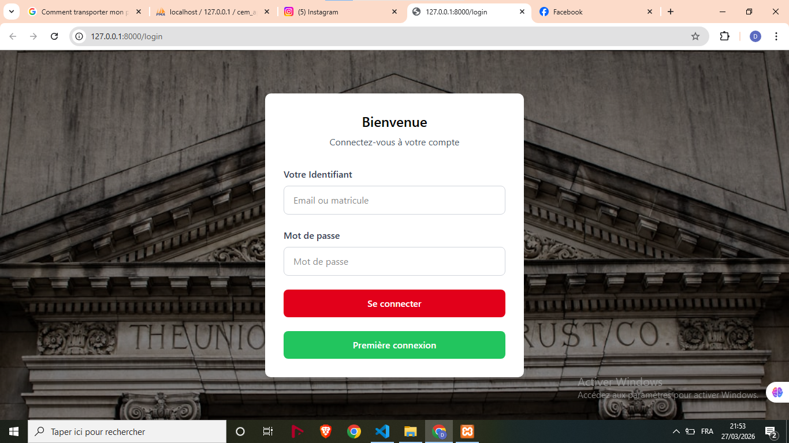
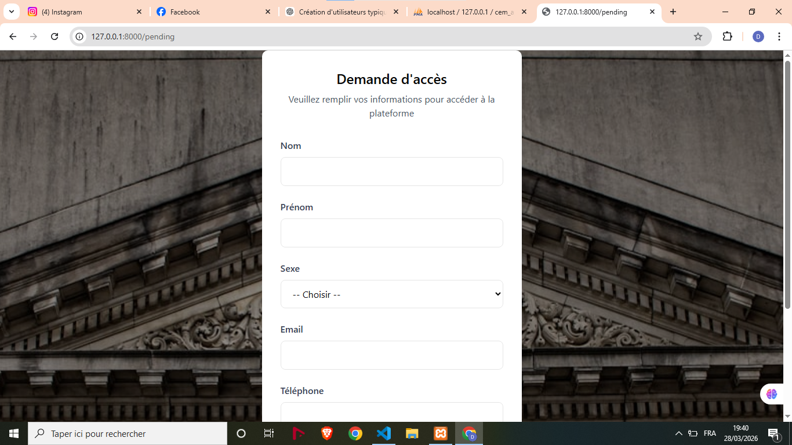
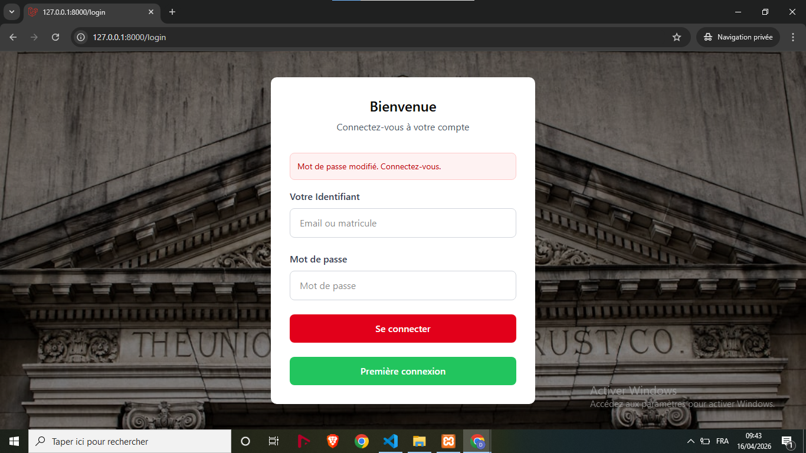
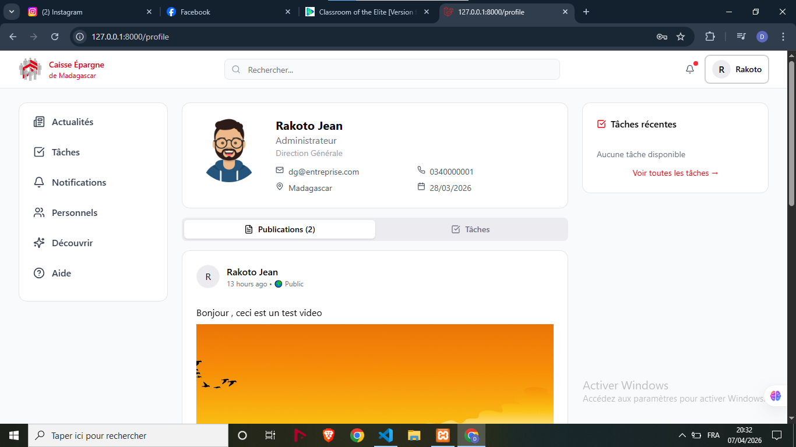
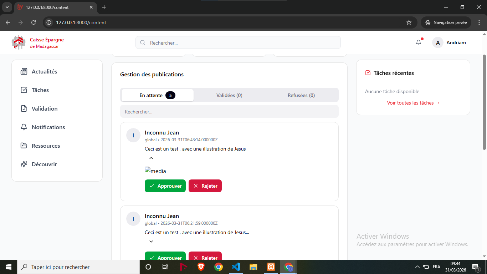
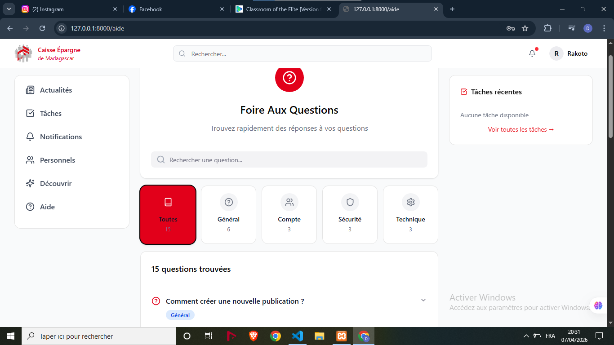

# 🌐 Intranet & Réseau Social d'Entreprise – Caisse d'Épargne de Madagascar

> **Application applicative de haut niveau conçue et déployée en autonomie dans le cadre de mon stage de fin de cycle au sein de la Caisse d'Épargne de Madagascar (CEM).**

Ce réseau social d'entreprise a été développé pour briser le cloisonnement des services et dynamiser la communication interne des collaborateurs à travers une interface fluide, sécurisée et connectée en temps réel.

---

## 🚀 Architecture Globale & Stack Technique

Le projet repose sur un choix architectural moderne : un **Monolithe épuré (Single Page Application)**. Ce paradigme permet d'associer la robustesse d'un serveur métier à la réactivité d'une interface client avancée, sans la complexité de gestion d'une API REST externe.

*   **Back-End :** PHP 8.x / **Laravel** (Middlewares de restriction, contrôleurs stricts, gestion des files d'attente d'e-mails).
*   **Front-End :** **React TypeScript** (Composants fortement typés, interface utilisateur dynamique).
*   **Couplage & Unification :** **Inertia.js** (Passerelle permettant d'injecter les données du contrôleur Laravel directement comme `props` dans les composants React).
*   **Temps Réel & WebSockets :** **Laravel Reverb** & **Channels** (Gestion des notifications instantanées de l'administrateur, des alertes UX et du rafraîchissement des flux).
*   **Base de Données :** **MySQL** (Modélisation relationnelle complète avec intégrité référentielle stricte via les migrations).

---

## 🔒 Workflows de Sécurité & Logique Métier (Spécification Bancaire)

Pour répondre aux exigences de sécurité du secteur bancaire, l'application bannit toute inscription publique et impose une validation humaine stricte pour les accès et le contenu.

### 👥 1. Tunnel d'Accès Collaborateur & Validation RH
*   **Absence d'inscription publique :** Il n'existe aucun formulaire d'inscription libre. 
*   **Demande d'Accès :** Depuis l'écran de Login, un bouton *Première connexion* redirige vers un formulaire de demande d'accès. L'utilisateur doit renseigner : *Nom, Prénom, Numéro de téléphone, Sexe, et son Matricule officiel*.
*   **Interface d'Administration "Personnels" :** La demande est envoyée à l'administrateur. Grâce à **Laravel Reverb**, l'administrateur reçoit une notification instantanée en temps réel. 
*   **Vérification de l'existence réelle :** L'administrateur accède à une interface spécifique où il gère les employés de l'entreprise (Ajout/Suppression). En cliquant sur *Vérifier*, l'application compare les données saisies par le demandeur avec les informations réelles de la base de données de la banque pour confirmer l'identité de l'employé.
*   **Approbation & Mot de passe temporaire :** L'administrateur approuve ou refuse. En cas d'approbation, le système génère et envoie automatiquement un e-mail au collaborateur contenant son matricule et un mot de passe temporaire.
*   **Initialisation du compte :** Lors de sa première connexion avec ses identifiants temporaires, l'utilisateur est intercepté par un *Middleware* et redirigé vers une interface de modification obligatoire pour définir son mot de passe définitif, avant de pouvoir se connecter définitivement.

### 📢 2. Gestion des Publications & Confidentialité Scopée
Le flux de communication interne offre une grande flexibilité tout en restant entièrement maîtrisé :
*   **Contenu Multi-médias :** Les collaborateurs peuvent publier des textes seuls, des fichiers uniques ou des compositions multimédias combinant du texte avec des images, des vidéos ou des documents (PDF, Docx, etc.).
*   **Segmentation de la Confidentialité :** Lors de la création, la portée de la publication peut être configurée. Elle peut être **globale** (visible par l'ensemble de l'entreprise), restreinte par **direction**, ou ciblée par **service informatique/métier** spécifique.
*   **Modération (Content Manager) :** Toute nouvelle publication soumise par un collaborateur n'est pas mise en ligne immédiatement. Elle est acheminée vers un espace de modération (**Content Manager**) pour être examinée par un responsable avant d'être validée ou rejetée pour la publication officielle.

### 🔔 3. Système d'Alertes UX & Notifications en Temps Réel
Afin de garantir un retour utilisateur optimal et une interactivité dynamique, un système d'alertes contextuelles et de notifications instantanées (propulsé par Laravel Reverb) se déclenche à chaque action majeure du cycle de vie de l'application :
*   Demande d'accès envoyée ou validée par l'administrateur.
*   Mot de passe modifié avec succès lors du parcours de première connexion.
*   Publication soumise avec succès au Content-Manager.
*   Publication validée ou refusée par le responsable de modération.
*   Apparition d'une nouvelle publication sur le fil d'actualité.
*   Interactions instantanées (likes, commentaires) sur les publications du réseau social.

---

## 📸 Démonstration Visuelle & Parcours Utilisateur

*Tous les visuels ci-dessous proviennent de l'application finale issue du dossier `screenshots/`.*

### 🔐 Authentification & Demande d'Accès

| Écran de Connexion (Login) | Formulaire de Demande d'Accès | Parcours Première Connexion (Reset) |
| :---: | :---: | :---: |
|  |  |  |

### 💼 Espace Administration & Modération

| Gestion des Employés (Personnels) | Modération des Flux (Content Manager) | Center d'Aide & FAQ |
| :---: | :---: | :---: |
|  |  |  |

---

## 🛠️ Instructions pour le Déploiement Local (R&D)

Pour exécuter ce projet sur votre environnement de développement :

```bash
# 1. Cloner le dépôt
git clone https://github.com

# 2. Installer les dépendances serveur (PHP/Laravel)
composer install

# 3. Installer les dépendances de l'interface (React/TypeScript)
npm install

# 4. Configurer les variables d'environnement
cp .env.example .env
php artisan key:generate

# 5. Exécuter la structure de la base de données
php artisan migrate

# 6. Lancer l'environnement de développement simultané
php artisan serve
npm run dev

# 7. Initialiser le serveur de WebSockets temps réel
php artisan reverb:start
```

---
*Projet développé avec rigueur, intégrité et passion par Hasiniavo David Rasolohery (2026).*
